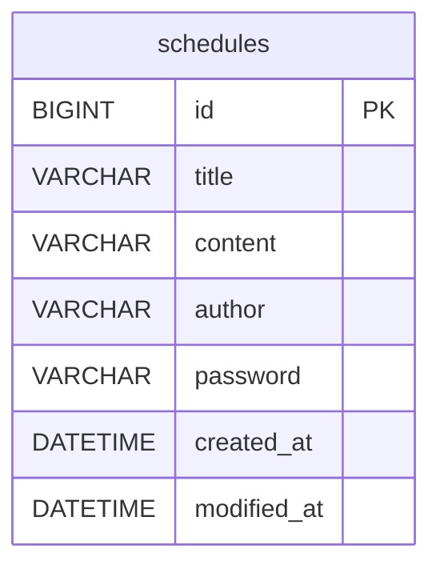

# 일정 관리 앱 (Schedule)

## 1. 프로젝트 소개

Spring Boot와 JPA를 활용한 일정 관리 REST API 프로젝트입니다.
일정 생성, 조회, 수정, 삭제 기능을 구현하는 것이 목표입니다.

## 2. 개발 환경

- Java 17
- Spring Boot
- Spring Data JPA
- MySQL
- Gradle
- Lombok
- Postman

## 3. API 명세서

| 기능 | Method | URL | 성공 상태 코드 |
|---|---|---|---|
| 일정 생성 | POST | /schedules | 201 Created |
| 전체 일정 조회 | GET | /schedules | 200 OK |
| 단건 일정 조회 | GET | /schedules/{id} | 200 OK |
| 일정 수정 | PATCH | /schedules/{id} | 200 OK |
| 일정 삭제 | DELETE | /schedules/{id} | 204 No Content |

### 일정 생성

POST /schedules

Request Body

```json
{
    "title": "Spring 공부",
    "content": "일정 관리 앱 구현하기",
    "author": "작성자",
    "password": "1234"
}
```

Response Body

```json
{
    "id": 1,
    "title": "Spring 공부",
    "content": "일정 관리 앱 구현하기",
    "author": "작성자",
    "createdAt": "2026-11-26T12:00:00",
    "modifiedAt": "2026-11-26T12:00:00"
}
```

### 전체 일정 조회

GET /schedules

- 작성자명은 선택적인 검색 조건입니다.
- 수정일 기준 내림차순으로 정렬합니다.
- 작성자명 검색 예시: /schedules?author=작성자

Response Body

```json
[
    {
        "id": 1,
        "title": "Spring 공부",
        "content": "일정 관리 앱 구현하기",
        "author": "작성자",
        "createdAt": "2026-11-26T12:00:00",
        "modifiedAt": "2026-11-26T12:00:00"
    }
]
```

### 단건 일정 조회

GET /schedules/{id}

Response Body

```json
{
    "id": 1,
    "title": "Spring 공부",
    "content": "일정 관리 앱 구현하기",
    "author": "작성자",
    "createdAt": "2026-11-26T12:00:00",
    "modifiedAt": "2026-11-26T12:00:00"
}
```

### 일정 수정

PATCH /schedules/{id}

- 제목과 작성자명만 수정할 수 있습니다.
- 비밀번호가 일치해야 수정할 수 있습니다.
- 작성일은 유지하고 수정일은 갱신합니다.

Request Body

```json
{
    "title": "Spring 복습",
    "author": "수정된 작성자",
    "password": "1234"
}
```

Response Body

```json
{
    "id": 1,
    "title": "Spring 복습",
    "content": "일정 관리 앱 구현하기",
    "author": "수정된 작성자",
    "createdAt": "2026-11-26T12:00:00",
    "modifiedAt": "2026-11-26T13:00:00"
}
```

### 일정 삭제

DELETE /schedules/{id}

- 비밀번호가 일치할 경우 삭제합니다.

Request Body

```json
{
    "password": "1234"
}
```

Response

204 No Content (응답 본문 없음)

## 4. ERD



- ID는 자동 증가 방식으로 생성합니다.
- 작성일과 수정일은 JPA Auditing으로 관리합니다.
- 비밀번호는 API 응답에서 제외합니다.

## 5. 프로젝트 구조

- Controller: HTTP 요청 및 응답 처리
- Service: 비즈니스 로직 처리
- Repository: 데이터베이스 접근
- Entity: 데이터베이스 테이블 매핑
- DTO: 요청 및 응답 데이터 전달

## 6. 구현 진행 상황

- [x] Lv.0 API 명세서 및 ERD 작성
- [ ] Lv.1 일정 생성
- [ ] Lv.2 일정 조회
- [ ] Lv.3 일정 수정
- [ ] Lv.4 일정 삭제
- [ ] Lv.5 댓글 생성
- [ ] Lv.6 일정 단건 조회 업그레이드
- [ ] Lv.7 입력값 검증

현재 Entity, Repository, 생성 DTO 및 Service를 작성했으며,
MySQL 접속 인증 오류를 해결하고 있습니다.
