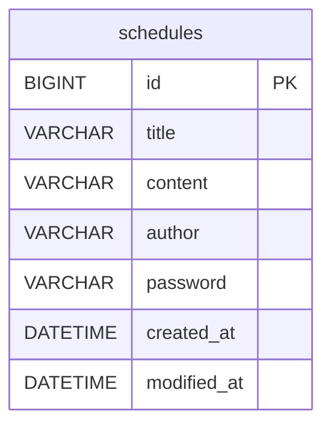

# 일정 관리 앱 (Schedule)

## 1. 프로젝트 소개

Spring Boot와 JPA를 활용한 일정 관리 REST API 프로젝트입니다.
일정 생성, 조회, 수정, 삭제 기능을 구현하는 것이 목표입니다.

## 2. 개발 환경

- Java 17
- Spring Boot
- Spring Data JPA
- MySQL
- Gradle
- Lombok
- Postman

## 3. API 명세서

| 기능 | Method | URL | 성공 상태 코드 |
|---|---|---|---|
| 일정 생성 | POST | /schedules | 201 Created |
| 전체 일정 조회 | GET | /schedules | 200 OK |
| 단건 일정 조회 | GET | /schedules/{id} | 200 OK |
| 일정 수정 | PATCH | /schedules/{id} | 200 OK |
| 일정 삭제 | DELETE | /schedules/{id} | 204 No Content |

### 일정 생성

POST /schedules

Request Body

```json
{
    "title": "Spring 공부",
    "content": "일정 관리 앱 구현하기",
    "author": "작성자",
    "password": "1234"
}
```

Response Body

```json
{
    "id": 1,
    "title": "Spring 공부",
    "content": "일정 관리 앱 구현하기",
    "author": "작성자",
    "createdAt": "2026-11-26T12:00:00",
    "modifiedAt": "2026-11-26T12:00:00"
}
```

### 전체 일정 조회

GET /schedules

- 작성자명은 선택적인 검색 조건입니다.
- 수정일 기준 내림차순으로 정렬합니다.
- 작성자명 검색 예시: /schedules?author=작성자

Response Body

```json
[
    {
        "id": 1,
        "title": "Spring 공부",
        "content": "일정 관리 앱 구현하기",
        "author": "작성자",
        "createdAt": "2026-11-26T12:00:00",
        "modifiedAt": "2026-11-26T12:00:00"
    }
]
```

### 단건 일정 조회

GET /schedules/{id}

Response Body

```json
{
    "id": 1,
    "title": "Spring 공부",
    "content": "일정 관리 앱 구현하기",
    "author": "작성자",
    "createdAt": "2026-11-26T12:00:00",
    "modifiedAt": "2026-11-26T12:00:00"
}
```

### 일정 수정

PATCH /schedules/{id}

- 제목과 작성자명만 수정할 수 있습니다.
- 비밀번호가 일치해야 수정할 수 있습니다.
- 작성일은 유지하고 수정일은 갱신합니다.

Request Body

```json
{
    "title": "Spring 복습",
    "author": "수정된 작성자",
    "password": "1234"
}
```

Response Body

```json
{
    "id": 1,
    "title": "Spring 복습",
    "content": "일정 관리 앱 구현하기",
    "author": "수정된 작성자",
    "createdAt": "2026-11-26T12:00:00",
    "modifiedAt": "2026-11-26T13:00:00"
}
```

### 일정 삭제

DELETE /schedules/{id}

- 비밀번호가 일치할 경우 삭제합니다.

Request Body

```json
{
    "password": "1234"
}
```

Response

204 No Content (응답 본문 없음)

## 4. ERD



- ID는 자동 증가 방식으로 생성합니다.
- 작성일과 수정일은 JPA Auditing으로 관리합니다.
- 비밀번호는 API 응답에서 제외합니다.

## 5. 프로젝트 구조

- Controller: HTTP 요청 및 응답 처리
- Service: 비즈니스 로직 처리
- Repository: 데이터베이스 접근
- Entity: 데이터베이스 테이블 매핑
- DTO: 요청 및 응답 데이터 전달

## 6. 설계 및 개념 정리

### 6-1. 3 Layer Architecture를 사용하는 이유

하나의 클래스에서 요청 처리, 비즈니스 로직,
데이터베이스 접근을 모두 담당하면 코드가 길어지고
가독성이 떨어지며 유지보수가 어려워집니다.

이를 방지하기 위해 각 계층의 역할과 책임을 분리합니다.

- Controller: 클라이언트의 요청 처리 및 응답 반환
- Service: 비즈니스 로직 처리 및 비밀번호 검증
- Repository: 데이터베이스 접근 및 데이터 관리

각 계층의 역할을 분리하면 코드의 가독성, 재사용성,
유지보수성이 향상되며 특정 기능을 수정할 때
다른 계층에 미치는 영향을 줄일 수 있습니다.

### 6-2. @RequestParam

URL의 쿼리 파라미터 값을 전달받는 어노테이션입니다.

주로 검색 조건이나 필터링에 사용합니다.
required = false를 설정하면 해당 값을 필수로
전달하지 않아도 됩니다.

이번 프로젝트에서는 전체 일정 조회 시 작성자명을
선택적인 검색 조건으로 전달받기 위해 사용했습니다.

### 6-3. @PathVariable

URL 경로에 포함된 값을 매개변수로 전달받는 어노테이션입니다.

주로 특정 데이터를 식별하기 위해 사용합니다.

이번 프로젝트에서는 일정 ID를 전달받아
단건 조회, 수정, 삭제 기능을 처리하기 위해 사용했습니다.

### 6-4. @RequestBody

HTTP 요청 본문에 담긴 JSON 데이터를 Java 객체로
변환하여 전달받는 어노테이션입니다.

Request DTO와 함께 사용하여 요청에 필요한 데이터를
정의하고 Entity와 요청 데이터를 분리할 수 있습니다.

이번 프로젝트에서는 일정 생성, 수정, 삭제 요청에
필요한 데이터를 전달받기 위해 사용했습니다.

### 6-5. 의존성 주입(DI)의 필요성

의존성 주입은 필요한 객체를 직접 생성하지 않고
외부에서 전달받아 사용하는 방식입니다.

Spring이 객체의 생성과 관리를 담당하므로
객체 간 결합도를 낮출 수 있으며 유지보수와
테스트가 쉬워집니다.

이번 프로젝트에서는 @RequiredArgsConstructor를
활용한 생성자 주입 방식을 사용했습니다.

Controller에는 Service를 주입하고,
Service에는 Repository를 주입하여 사용했습니다.

## 7. 구현 진행 상황

- [x] Lv.0 API 명세서 및 ERD 작성
- [x] Lv.1 일정 생성
- [x] Lv.2 일정 조회
- [x] Lv.3 일정 수정
- [x] Lv.4 일정 삭제
- [ ] Lv.5 댓글 생성
- [ ] Lv.6 일정 단건 조회 업그레이드
- [ ] Lv.7 입력값 검증

현재 Entity, Repository, 생성 DTO 및 Service를 작성했으며,
MySQL 접속 인증 오류를 해결하고 있습니다.
